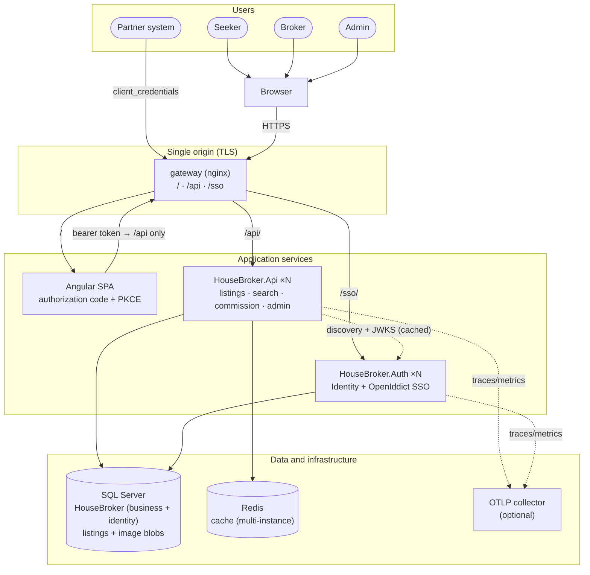
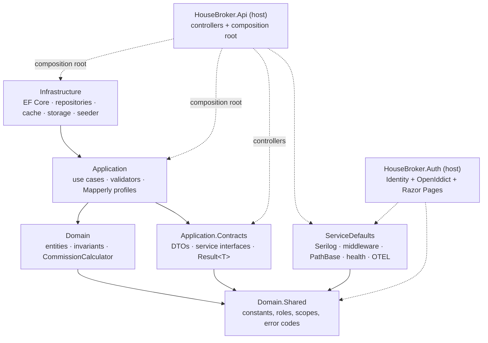
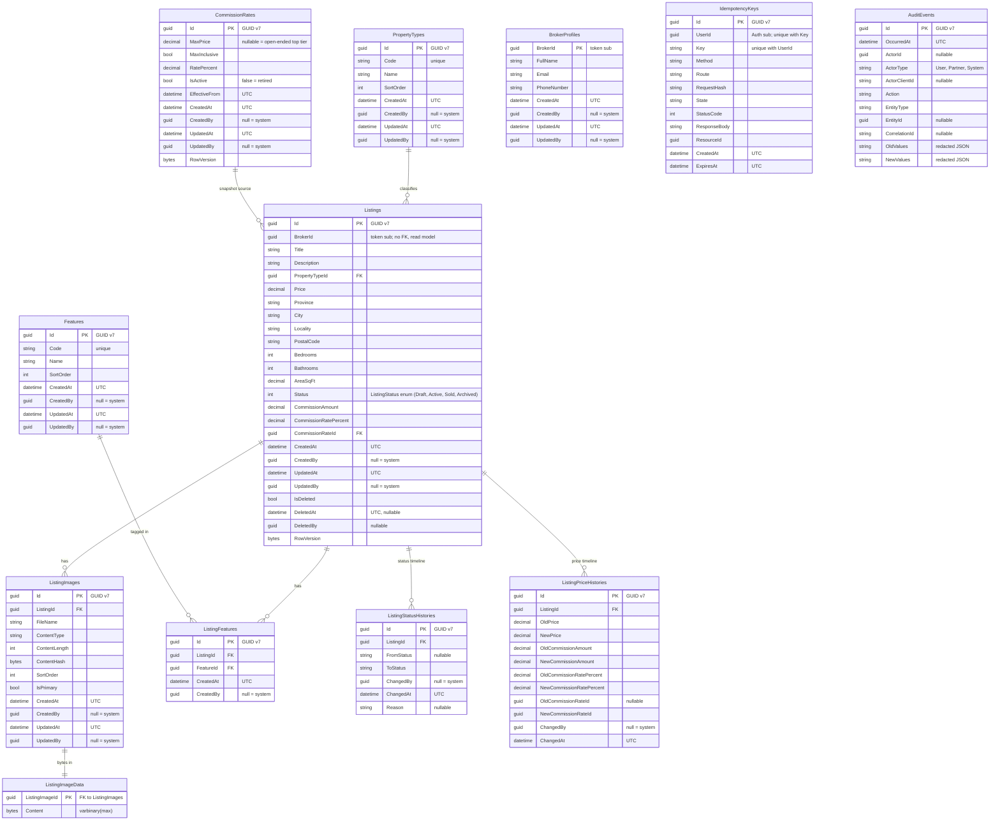
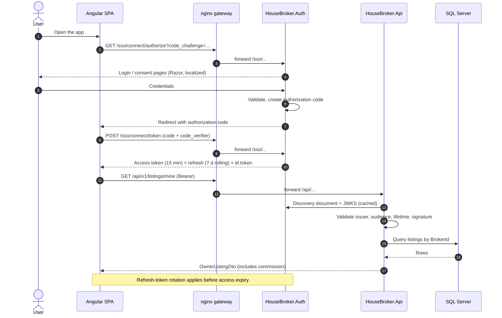
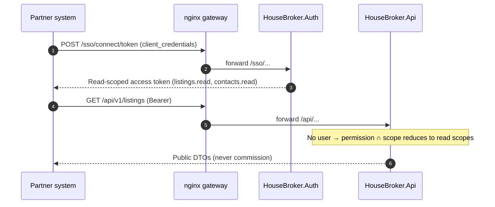
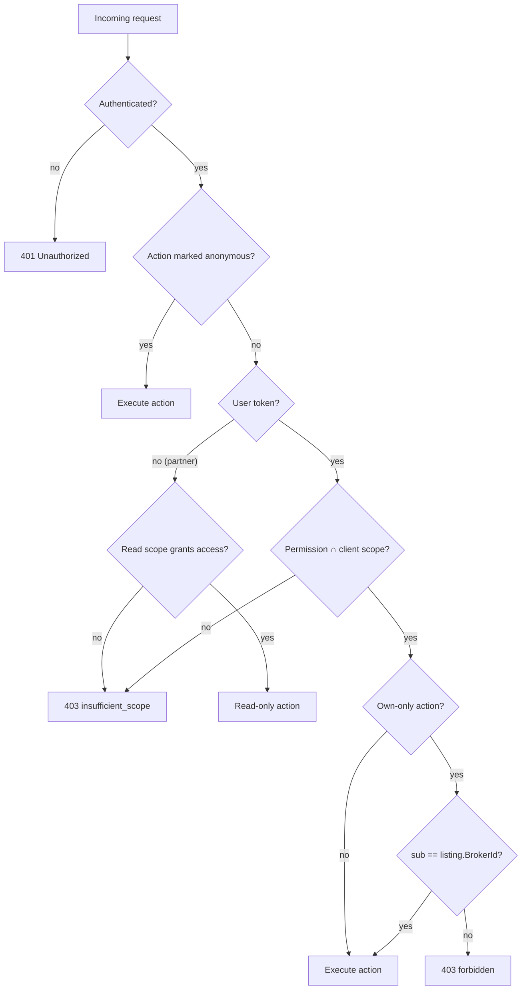
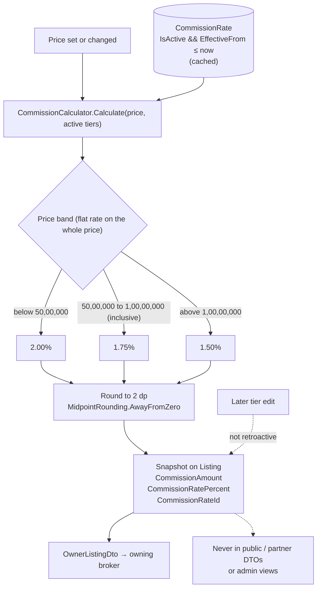
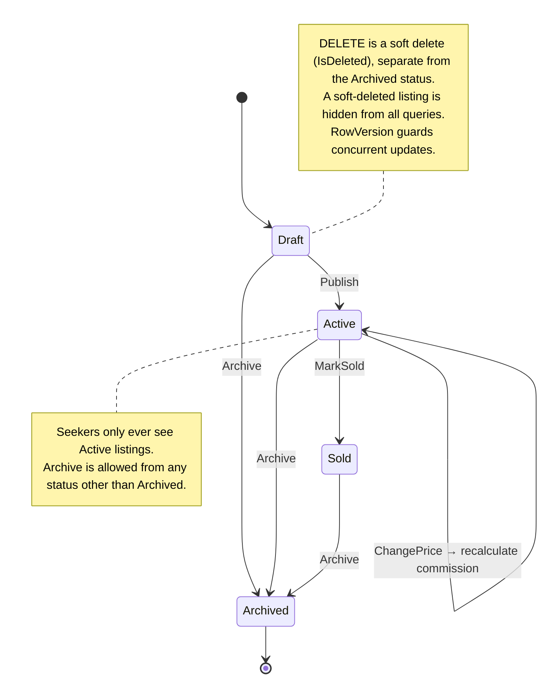
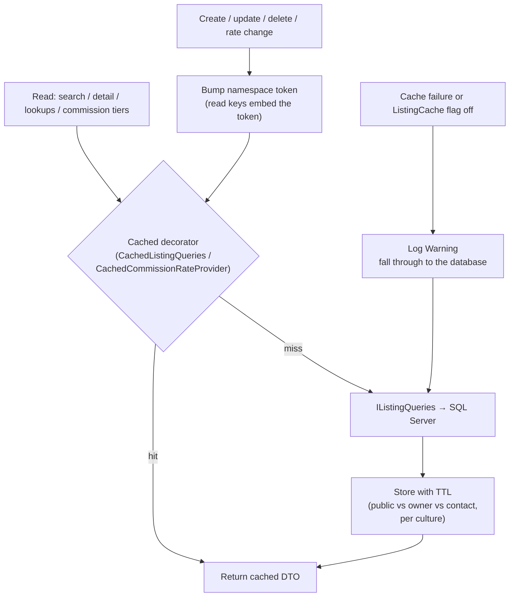
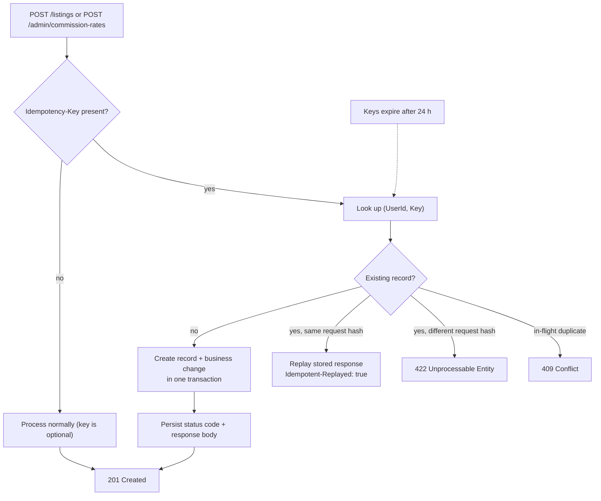

# House Broker — Diagrams

> Derived from the plan. If an architecture decision changes, update [02-decisions.md](plan/02-decisions.md) or [03-architecture.md](plan/03-architecture.md) first, then this page. Rendering requires Mermaid support (GitHub renders it natively).

## 1. System context and containers

## 2. Clean Architecture dependency rules

Solid arrows are project references; dotted arrows are host/composition-root use only.

Enforced by `HouseBroker.Architecture.Tests`. Domain, Contracts and Application never reference EF Core, ASP.NET or Serilog.

## 3. Data model (`HouseBroker` database)

Table names are plural PascalCase; entity classes are singular PascalCase. Every primary key and foreign key is `uniqueidentifier` (GUID v7, generated in the application). Mutable entities carry `CreatedAt`/`CreatedBy`/`UpdatedAt`/`UpdatedBy`; soft-deleted entities also carry `DeletedAt`/`DeletedBy`. `ListingStatusHistories`, `ListingPriceHistories` and `AuditEvents` are append-only, and there is no generic application logs table.

All tables live in the single `HouseBroker` database; business tables use the `dbo` schema and Identity/OpenIddict tables use the `identity` schema.

## 4. Authentication: authorization code + PKCE

Partners use `client_credentials` and receive read-only scopes:

## 5. Request authorization decision

Ownership is a resource-based check in the service layer; default deny is the fallback policy.

## 6. Commission calculation and snapshot

Tier configuration is validated as a whole: at least one active band, exactly one open-ended top band, and bounded maxima that are strictly positive and strictly increasing. Lower bounds are derived from the previous band, so gaps and overlaps cannot occur.

## 7. Listing lifecycle

## 8. Cache read path and invalidation

`ListingService` contains no cache code; caching is a decorator. A write on one instance invalidates reads on another with the Redis provider.

## 9. Idempotent resource creation

Keys are scoped per user and cleaned up by an idempotent background job.
