# House Broker User Manual (End-to-End Journey)

**Date:** 2026-11-04  
**Environment:** local development stack  
**Base URLs:** SPA `http://localhost:4200`, API `http://localhost:5049/api`, SSO `http://localhost:5222/sso`  
**Evidence screenshots:** `tests/e2e/artifacts/manual-e2e/` (captured during the manual Chrome DevTools pass)

This manual records the full end-to-end user journey that was exercised manually against the running House Broker application, together with screenshots saved as evidence. It is written for product reviewers, QA and onboarding users; it is not the internal engineering plan.

## Demo accounts used

| Role | Email | Password |
|---|---|---|
| Seeker | `seeker@demo.com` | `Password123!` |
| Broker | `broker1@demo.com` | `Password123!` |
| Admin | `admin@housebroker.com` | `AdminPassword123!` |
| Partner client | `demo-partner` (client credentials) | `partner_secret_123` |

> Passwords come from the Development user-secrets store. They are only valid for the seeded Development environment.

## Journey 1 - Anonymous discovery

1. Open `/`. The home page loads with the search box and the “Browse all listings” link.
2. Open `/search`. Filter fields (location, min/max price, type, bedrooms, sort) are available; active listings are paged.
3. Open an active listing. The detail page shows title, price, location, description, features, images and **broker contact** (raw R13 behaviour).
4. Confirm that **no commission fields** appear for an anonymous viewer.

**Evidence**

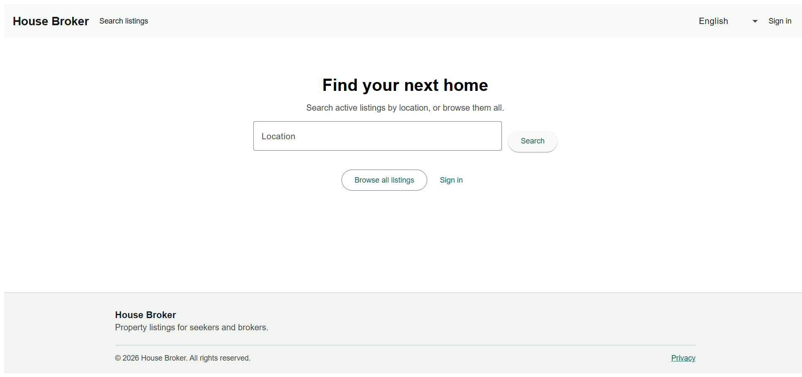

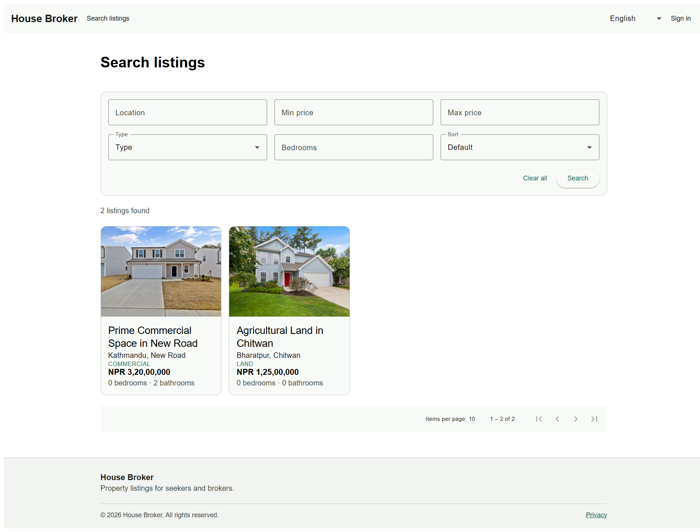

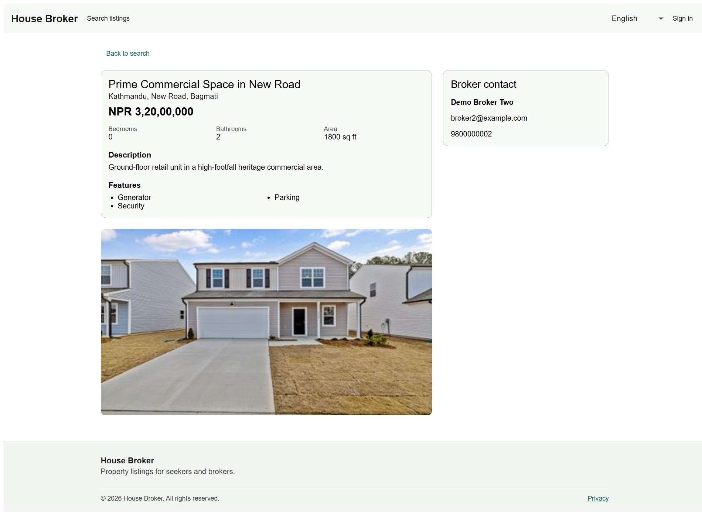

## Journey 2 - Localization

1. Use the language selector in the header.
2. Switch from English to Nepali (`ne`) and back.
3. UI chrome, labels and machine-formatted prices update; broker-entered text and locations remain as entered.

**Evidence**

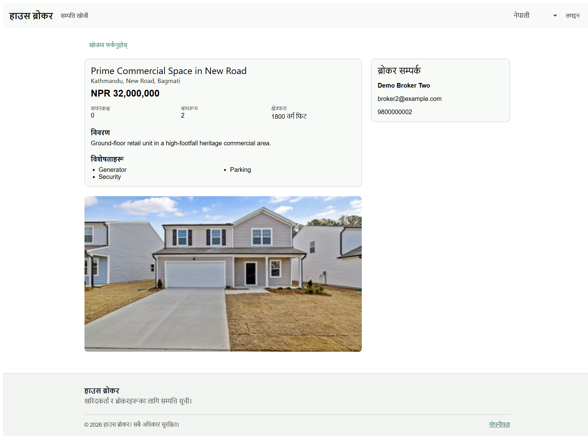

## Journey 3 - Broker: manage own listings and commission

1. Sign in as `broker1@demo.com`.
2. Open **My listings** (`/broker/listings`). The broker sees only their own listings; commission is visible per listing.
3. **Create listing**: fill the create dialog (basics, price, type, location, details) and save. A draft listing is created with the snapshotted commission for its price tier.
4. **Publish** a draft listing; it becomes visible on the anonymous search page.
5. **Edit** a listing, change the price and save. Commission is recalculated from the new price tier (e.g. 75,00,000 → 1,31,250 at 1.75%; 1,10,00,000 → 1,65,000 at 1.5%).
6. **Mark sold**, then **archive**, then **delete** (soft delete) a listing using *More actions*.
7. Expand **Photos** to review an existing image, the “primary” flag, the upload control and the delete-image action.

**Evidence**

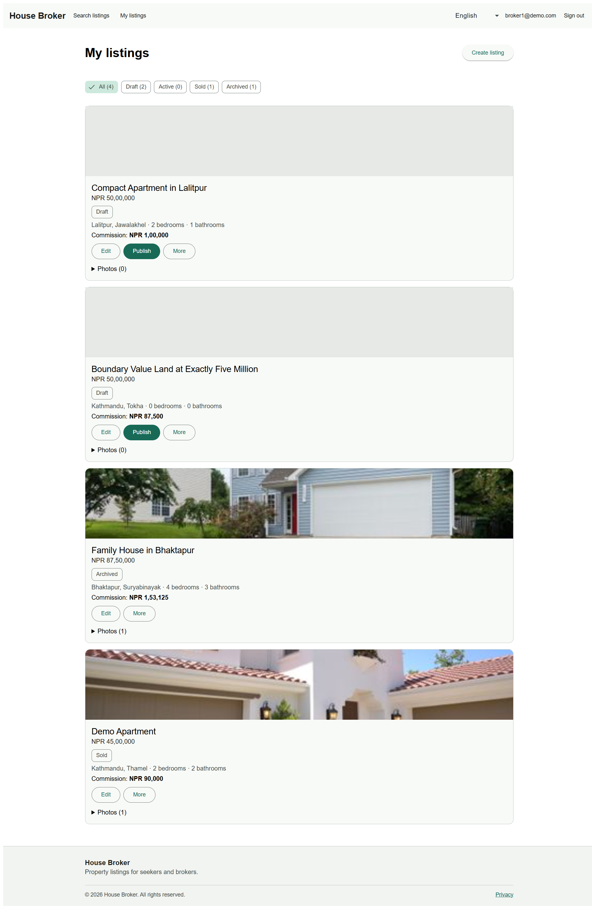

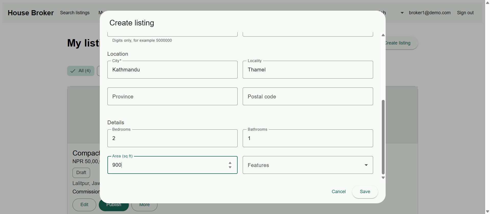

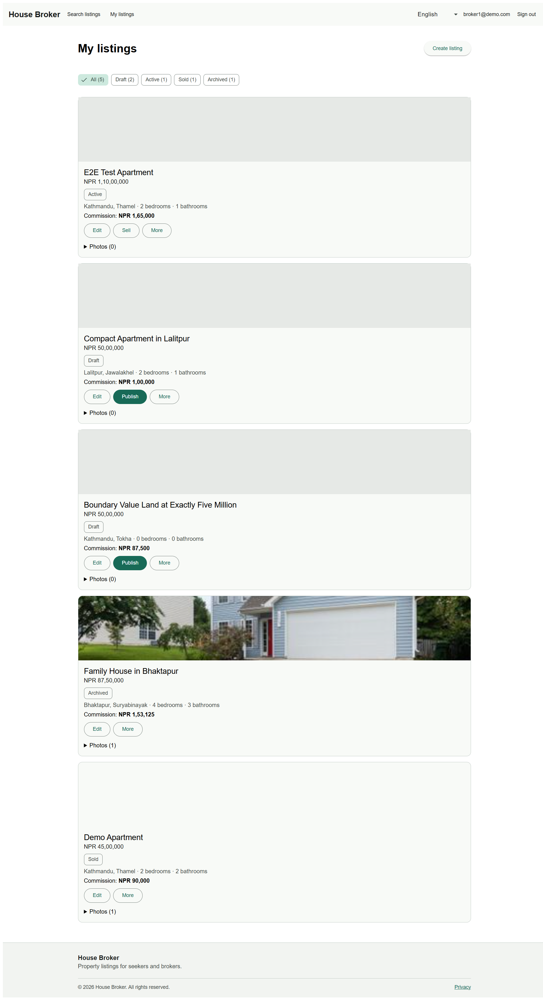

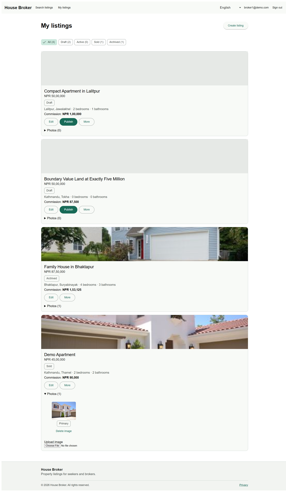

### Commission rule observed

| Price band | Rate | Observed example |
|---|---|---|
| `< 50,00,000` | 2.00% | 45,00,000 → 90,000 |
| `50,00,000 … 1,00,00,000` (both inclusive) | 1.75% | 50,00,000 → 87,500; 75,00,000 → 1,31,250 |
| `> 1,00,00,000` | 1.50% | 1,10,00,000 → 1,65,000 |

## Journey 4 - Admin: manage commission rate tiers

1. Sign in as `admin@housebroker.com`.
2. Open **Commission rates** (`/admin/commission-rates`).
3. The three seeded tiers are displayed with min/max bounds, rate, effective date and active flag.
4. Open **New rate** to inspect the tier editor (min/max inclusivity flags, effective date, active toggle).
5. Close with Cancel to keep the seeded tier set unchanged.

**Evidence**

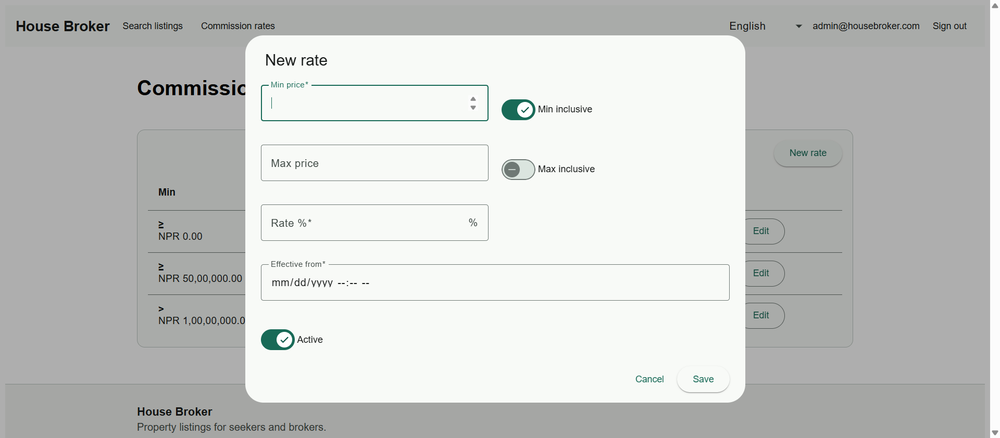

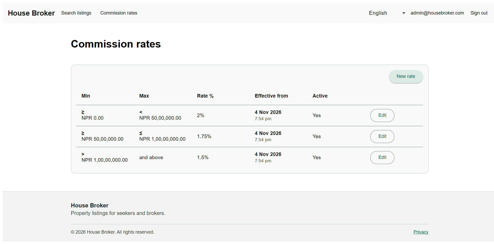

## Journey 5 - Seeker: browse without commission or write access

1. Sign in as `seeker@demo.com`.
2. Search and open an active listing. Broker contact is visible; **no commission fields** are shown and **no create/manage controls** are offered.

**Evidence**

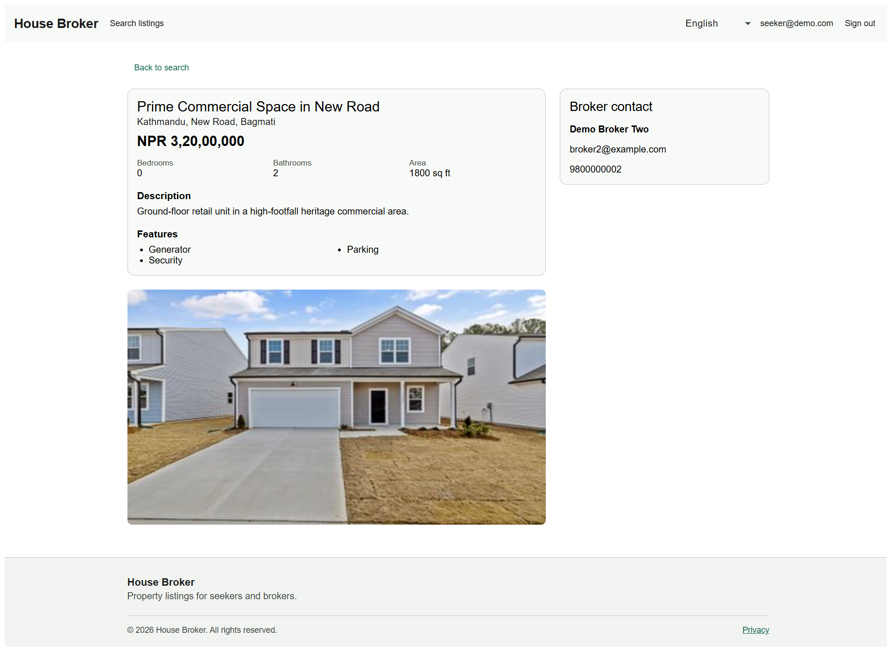

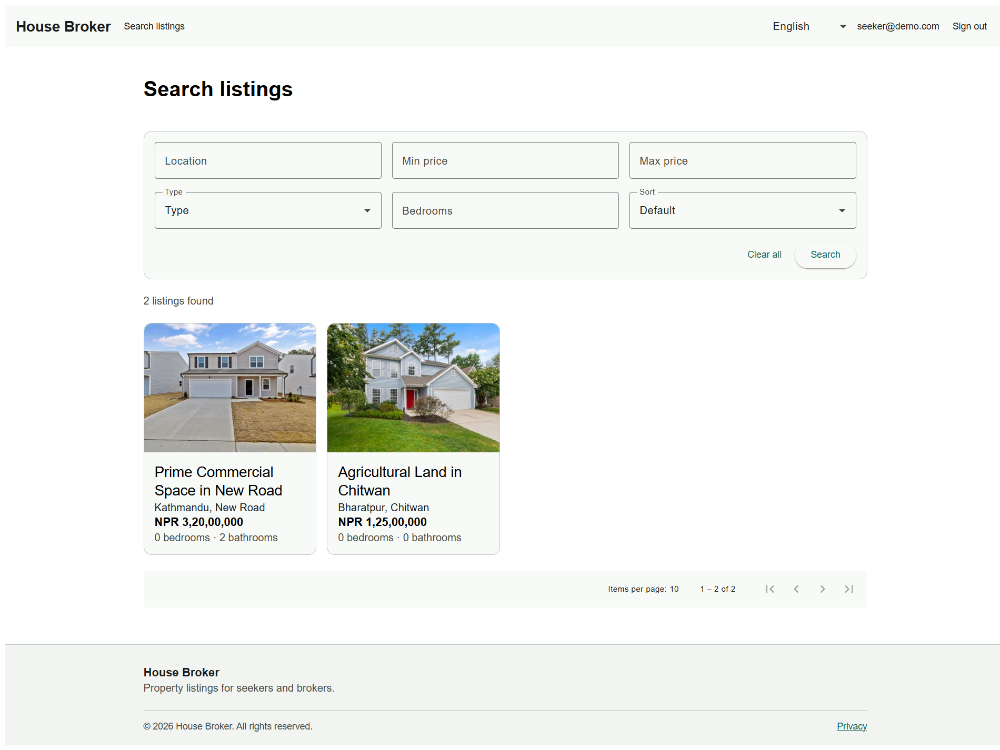

## Journey 6 - Partner API (client credentials)

1. Obtain an access token:

   ```powershell
   curl.exe -s -X POST http://localhost:5222/sso/connect/token `
     -H "Content-Type: application/x-www-form-urlencoded" `
     -d "grant_type=client_credentials&client_id=demo-partner&client_secret=partner_secret_123&scope=listings.read contacts.read"
   ```

2. Call the public listing read API with `Authorization: Bearer <token>`:

   ```powershell
   curl.exe -s http://localhost:5049/api/v1/listings -H "Authorization: Bearer <token>"
   ```

   The response contains listing data and **no commission fields**.

3. Attempt a write (POST `/api/v1/listings`) with the same token → `403 Forbidden`, because the partner only holds read scopes.

## Journey 7 - Responsive (mobile)

1. Resize the browser to a mobile viewport (390×844).
2. The search/detail layout reflows and remains usable; primary actions stay reachable.

**Evidence**

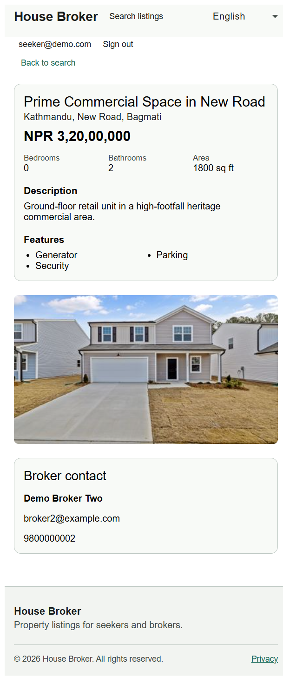

## Observations from the pass

- No JavaScript console errors or failed network requests were recorded during the pass.
- URLs use a single `/api` path base (`/api/v1/...`); no duplicate `/api/api` paths.
- Public and partner responses do not expose commission fields; commission appears only in the broker owner view.
- Commission recalculation follows the seeded flat-rate tiers on price change.
- Localization switches cleanly between English and Nepali.
- Rate limiting and header-level checks (`Content-Language`, `Vary`) are covered by the automated unit/contract and smoke tests rather than this manual session.

## Automated verification (Playwright)

The deferred Playwright suite under `tests/e2e` was executed against the same local stack:

- Command: `npm test -- --workers=1`
- Result: **12 passed, 0 failed** (smoke, partner, broker CRUD/lifecycle, commission boundaries, admin rates, concurrency/idempotency, image upload, localization/contact).
- Browser/UI auth spec was corrected to assert an actually public active listing (`Prime Commercial Space`) instead of a sold demo listing.

A multi-worker run can trigger SQL deadlocks in the idempotency begin path under heavy parallel load; serial execution is the recommended local/CI mode until deadlock retry handling is added to `IdempotencyService`.

## Exit status

All user journeys listed above were exercised successfully. The seed data was left in its original state (no commission tiers were changed). The one new listing created during the broker flow was subsequently archived and deleted (soft delete).
